# MazdoorLink AI: Comprehensive Object-Oriented Analysis & Class Specification
## Based on Use Cases UC-01 through UC-29

**Author:** Bilal Aziz  
**System:** MazdoorLink AI  
**Project Root Directory:** `D:\Desktop\MazdoorLink\lib\`  
**Date Updated:** 2026  

---

## 1. Executive Summary & Architecture Overview

The **MazdoorLink AI** platform is designed to connect informal-sector skilled workers (e.g., Electricians, Plumbers, Carpenters) with customers across the twin-cities service area (Islamabad & Rawalpindi). The architecture follows a clean modular Flutter pattern featuring:

1. **Reactive State Management & Scoping:** Hierarchical `ChangeNotifier` controllers (`AppController`, `ChatUnreadController`) bound to the widget tree via `InheritedNotifier` (`AppScope`).
2. **Domain Models & DTOs:** Immutable domain representations (`WorkerModel`, `WorkerSkill`, `AppLocation`, `TwinCityArea`, `IssueItem`, `ServiceItem`) with serialization and factory constructors.
3. **Cross-Screen Routing Arguments:** Strong-typed navigation contracts (`RecommendationArguments`, `JobPostingArguments`, `ProfileArguments`, `TrackingArguments`, `ConversationArguments`, `ServicesSetupArguments`).
4. **Decoupled Service Layer:** Specialized singleton and utility services for Geolocation & Geofencing (`LocationService`), Payments (`SafepayService`), Cloudinary CDN (`CloudinaryService`), Bilingual Machine Translation (`TranslationService`), Direct SMTP (`SmtpService`), SMS Gateway (`SmsService`), Voice Navigation/LLM Assistant (`VoiceAssistantService`, `SpeechService`), and Firestore Presence & Jobs Lifecycle (`WorkerPresenceService`, `WorkersService`).
5. **UI Screen Hierarchy:** Modularized stateful and stateless screen controllers mapped directly to User Stories and Use Cases.

---

## 2. Use Case to Implementation Traceability Matrix

| Use Case ID | Use Case Name | Primary Actors | Key Implementing Classes | Implementation File & Line |
|---|---|---|---|---|
| **UC-01** | Customer Sign Up and Login | Customer, Firebase, SMTP, SMS, Location | `AuthScreen`, `_AuthScreenState`, `AuthLoginScreen`, `WelcomeScreen`, `AppController`, `SmtpService`, `SmsService`, `LocationService` | `lib/screens/auth_screen.dart:21` `lib/screens/welcome_screen.dart:4` `lib/app_state.dart:54` |
| **UC-02** | Customer Selects Service Category and Issue | Customer, Routing, Safepay | `CustomerHomeScreen`, `IssueSelectionScreen`, `_IssueSelectionScreenState`, `IssueItem`, `RecommendationArguments`, `JobPostingArguments`, `ServiceCategory` | `lib/screens/customer_home_screen.dart:20` `lib/screens/issue_selection_screen.dart:30, 44` `lib/screens/recommendation_arguments.dart:3` |
| **UC-03** | Intelligent Worker Filtering | Customer, Google Maps, Location, Firestore | `WorkerRecommendationsScreen`, `_WorkerRecommendationsScreenState`, `ConfirmLocationScreen`, `LocationService`, `SkillDeduplicator`, `WorkerModel`, `WorkerSkill` | `lib/screens/worker_recommendations_screen.dart:20` `lib/screens/job_posting_flow.dart:503` `lib/services/location_service.dart:97` `lib/data/mock_data.dart:39` |
| **UC-04** | Customer Hires Worker / Makes Offer | Customer, Worker, Firestore `jobs` | `FlowWorkerProfileScreen`, `_FlowWorkerProfileScreenState`, `ProfileArguments`, `TrackingArguments`, `ServiceTrackingScreen` | `lib/screens/worker_profile_screen.dart:41` `lib/screens/mazdoor_flow.dart:183, 195` `lib/screens/service_tracking_screen.dart:23` |
| **UC-05** | Real-Time Bilingual Chat between Customer and Worker | Customer, Worker, Firestore, Translation Service | `ConversationScreen`, `_ConversationScreenState`, `ChatHistoryScreen`, `ConversationArguments`, `TranslationService`, `ChatUnreadController` | `lib/screens/conversation_screen.dart:18, 197` `lib/screens/mazdoor_flow.dart:210` `lib/services/translation_service.dart:10` `lib/app_state.dart:13` |
| **UC-06** | Customer Views Job History | Customer, Firestore | `BookingHistoryScreen`, `_BookingHistoryScreenState`, `RatingReviewScreen`, `_BillRow` | `lib/screens/booking_history_screen.dart:18` `lib/screens/rating_review_screen.dart:21` |
| **UC-07** | Real-Time Worker Tracking Map | Customer, Worker, Google Maps, Geolocator | `WorkerTrackingScreen`, `_WorkerTrackingScreenState`, `ServiceTrackingScreen`, `_ServiceTrackingScreenState`, `TrackingMapScreen`, `LocationService` | `lib/screens/worker_tracking_screen.dart:11` `lib/screens/service_tracking_screen.dart:23` `lib/screens/tracking_map_screen.dart:5` |
| **UC-08** | Customer Cancels Job | Customer, Worker, Firestore | `CancelJobScreen`, `_CancelJobScreenState`, `_SectionLabel`, `_StyledDropdown` | `lib/screens/cancel_job_screen.dart:22, 695, 723` |
| **UC-09** | Customer Complaint and Admin Chat | Customer, Admin, Firestore, Cloudinary | `CustomerSupportScreen`, `_CustomerSupportScreenState`, `AdminComplaintsTab`, `_ComplaintCard`, `ConversationScreen`, `CloudinaryService` | `lib/screens/customer_support_screen.dart:7` `lib/screens/admin_complaints_tab.dart:12, 156` `lib/services/cloudinary_service.dart:6` |
| **UC-10** | Worker Sign Up, Login, and Approval | Worker, Admin, Firebase, Cloudinary, SMS, SMTP | `AuthScreen`, `WorkerVerificationScreen`, `_WorkerVerificationScreenState`, `WorkerSignupData`, `AdminWorkerRegistrationsTab`, `DocumentUploadScreen`, `CnicCapture` | `lib/screens/auth_screen.dart:21` `lib/screens/worker_verification_screen.dart:12` `lib/screens/signup_data.dart:1` `lib/screens/admin_worker_registrations_tab.dart:12` `lib/widgets/cnic_capture.dart:3` |
| **UC-11** | Worker Toggles Online/Offline Presence | Worker, Firestore | `WorkerDashboardScreen`, `_WorkerDashboardScreenState`, `WorkerPresenceService`, `WorkerHome` | `lib/screens/worker_dashboard_screen.dart:22` `lib/services/workers_service.dart:1459` `lib/screens/worker_home.dart:8` |
| **UC-12** | Worker Manages Skills and Rates | Worker, Firestore | `WorkerServicesSetupScreen`, `_WorkerServicesSetupScreenState`, `ServiceItem`, `ServicesSetupArguments`, `WorkerSkill` | `lib/screens/worker_services_setup_screen.dart:9, 23` `lib/screens/signup_data.dart:27` `lib/data/mock_data.dart:17` |
| **UC-13** | Worker Receives Job Offers | Worker, Customer, Firestore | `WorkerDashboardScreen`, `_WorkerDashboardScreenState`, `WorkerModel`, `WorkersService` | `lib/screens/worker_dashboard_screen.dart:22` `lib/services/workers_service.dart` |
| **UC-14** | Worker Accepts or Declines Job | Worker, Customer, Firestore | `WorkerDashboardScreen`, `_WorkerDashboardScreenState`, `WorkerTrackingScreen`, `NotificationService` | `lib/screens/worker_dashboard_screen.dart:22` `lib/screens/worker_tracking_screen.dart:11` `lib/services/notification_service.dart:22` |
| **UC-15** | Worker Views Earnings and Tops Up Balance | Worker, Safepay, Firestore | `EarningsDashboardScreen`, `_EarningsDashboardScreenState`, `_ColorStatCard`, `EarningsDashboard`, `SafepayService`, `SafepaySession` | `lib/screens/earnings_dashboard_screen.dart:9, 42` `lib/widgets/earnings_dashboard.dart:4` `lib/services/safepay_service.dart:7, 19` |
| **UC-16** | Worker Voice Navigation (Accessibility) | Worker, Speech Service | `VoiceNavigationScreen`, `_VoiceNavigationScreenState`, `SpeechService`, `VoiceAssistantService`, `VoiceSettings` | `lib/screens/voice_navigation_screen.dart:5` `lib/services/speech_service.dart:1` `lib/services/voice_assistant_service.dart:15` `lib/screens/voice_settings.dart:5` |
| **UC-17** | Customer and Worker Change App Language | Customer, Worker, Local Storage | `LanguageSelection`, `TranslationToggleScreen`, `SettingsScreen`, `AppController`, `AppLocalizations` | `lib/screens/language_selection.dart:4` `lib/screens/translation_toggle_screen.dart:4` `lib/screens/settings_screen.dart:22` `lib/app_state.dart:54` |
| **UC-18** | Admin Worker Approval Workflow | Administrator, Worker, Firestore, SMTP, SMS | `AdminWorkerRegistrationsTab`, `_AdminWorkerRegistrationsTabState`, `AdminDashboardScreen`, `AdminUserManagementTab`, `SmtpService`, `SmsService` | `lib/screens/admin_worker_registrations_tab.dart:12` `lib/screens/admin_dashboard_screen.dart:22` `lib/screens/admin_user_management_tab.dart:11` |
| **UC-19** | Admin Views Jobs and Applies Penalty | Administrator, Firestore `jobs`, Top-Up Balance | `JobsTab`, `_JobsTabState`, `AdminTransactionsScreen`, `AdminEarningsScreen` | `lib/screens/admin_jobs_screen.dart:4` `lib/screens/admin_transactions_screen.dart:7` `lib/screens/admin_earnings_screen.dart:10` |
| **UC-20** | Admin Views Platform Stats | Administrator, Firestore | `AdminStatsSheet`, `_AdminStatsSheetState`, `_LiveStatsCards`, `_LiveBarChart`, `_LiveCategoryBars`, `_StatsCard`, `_BarChartWidget` | `lib/screens/admin_dashboard_sheets.dart:265, 343, 447, 491, 541, 581` |
| **UC-21** | Admin Manages Damage Claims and Security Deposits | Administrator, Worker, Customer, Firestore | `AdminDamageClaimsSheet`, `AdminDepositsSheet`, `AdminComplaintsTab`, `WorkersService` | `lib/screens/admin_dashboard_sheets.dart:25, 167` `lib/screens/admin_complaints_tab.dart:12` |
| **UC-22** | Customer Adds Favourite Worker | Customer, Firestore | `FavoriteWorkersScreen`, `_FavoriteWorkersScreenState`, `FlowWorkerProfileScreen`, `SettingsScreen` | `lib/screens/settings_screen.dart:1121, 1127` `lib/screens/worker_profile_screen.dart:41` |
| **UC-23** | Customer Views Past and Active Bookings | Customer, Firestore | `BookingHistoryScreen`, `_BookingHistoryScreenState`, `_ReceiptLine` | `lib/screens/booking_history_screen.dart:18, 25` |
| **UC-24** | Customer Rates Worker | Customer, Worker, Firestore | `RatingReviewScreen`, `_RatingReviewScreenState`, `PostJobStep` | `lib/screens/rating_review_screen.dart:9, 21, 28` |
| **UC-25** | Customer Pays for Services | Customer, Safepay, Firestore, Worker | `RatingReviewScreen`, `WorkerTrackingScreen`, `IssueSelectionScreen`, `SafepayService` | `lib/screens/rating_review_screen.dart:21` `lib/screens/worker_tracking_screen.dart:11` `lib/services/safepay_service.dart:19` |
| **UC-26** | Worker Tops Up Account Balance | Worker, Safepay, Firestore | `EarningsDashboardScreen`, `_EarningsDashboardScreenState`, `SafepayService`, `SafepaySession` | `lib/screens/earnings_dashboard_screen.dart:42` `lib/services/safepay_service.dart:19` |
| **UC-27** | Users Control App Functions Using Voice Commands | All Users, Speech Service | `VoiceOverlaySheet`, `_VoiceOverlaySheetState`, `VoiceAssistantService`, `SpeechService`, `AdminVoiceSheet` | `lib/widgets/mz_scaffold.dart:391` `lib/services/voice_assistant_service.dart:15` `lib/screens/admin_dashboard_sheets.dart:726` |
| **UC-28** | Customers and Workers Upload Profile Pictures | Customer, Worker, Cloudinary, Firestore | `ProfileManagementScreen`, `_ProfileManagementScreenState`, `CloudinaryService` | `lib/screens/profile_management_screen.dart:13, 20` `lib/services/cloudinary_service.dart:6` |
| **UC-29** | Users Change App Language | All Users, Local Settings Storage | `LanguageSelection`, `SettingsScreen`, `AppController`, `AppLocalizations` | `lib/screens/language_selection.dart:4` `lib/screens/settings_screen.dart:22` `lib/app_state.dart:54` `lib/l10n/app_localizations.dart:3` |

---

## 3. Detailed Class Specifications: Attributes, Functions, File, & Line Numbers

### 3.1 Core State & Application Scope

#### `UserRole`
- **File:** `lib/app_state.dart`
- **Line:** 9
- **Type:** `enum`
- **Values:** `customer`, `worker`, `admin`
- **Description:** Enumerates system user privileges and view modes across all flows.

#### `ChatUnreadController`
- **File:** `lib/app_state.dart`
- **Line:** 13
- **Inheritance:** `extends ChangeNotifier`
- **Attributes:**
  - `int _total`: Total unread messages across all active user conversations.
  - `StreamSubscription<QuerySnapshot>? _sub`: Live Firestore listener on `conversations` collection.
  - `int get total`: Public getter returning `_total`.
- **Functions:**
  - `void start()`: Initiates real-time subscription to `streamConversations()` and aggregates per-user unread counts.
  - `void reset()`: Cancels stream subscription and zeroes out `_total`.
  - `void dispose()`: Lifecycle cleanup method.

#### `AppController`
- **File:** `lib/app_state.dart`
- **Line:** 54
- **Inheritance:** `extends ChangeNotifier`
- **Attributes:**
  - `UserRole? role`: Current authenticated role.
  - `Locale locale`: Active application language (`en` or `ur`).
  - `final ChatUnreadController chatUnread`: Embedded unread message badge manager.
  - `String activeRole`: Persisted active role identifier (`'customer'` or `'worker'`).
  - `bool get isUrdu`: Convenience boolean getter (`locale.languageCode == 'ur'`).
- **Functions:**
  - `AppController({String? initialLocale})`: Constructor with automatic local preference retrieval.
  - `Future<void> _loadPersistedLocale()`: Asynchronously retrieves cached locale from `SharedPreferences`.
  - `Future<void> _persistLocale(String langCode)`: Caches language preference into disk.
  - `void selectRole(UserRole value, {bool updateLocale = false})`: Switches global user role and triggers notification token refresh.
  - `void switchActiveRole(UserRole value)`: Seamless in-app dual-role switching between Customer and Worker.
  - `void setLocale(Locale value)`: Sets language to English or Urdu and notifies UI listeners.
  - `void toggleLanguage()`: Toggles instantly between English and Urdu.
  - `Future<void> logout()`: Sets worker presence to offline in Firestore, calls `FirebaseAuth.instance.signOut()`, and resets state.
  - `Future<void> _persistActiveRole(String roleName)`: Writes active role string to `SharedPreferences`.
  - `void dispose()`: Disposes internal controllers.

#### `AppScope`
- **File:** `lib/app_state.dart`
- **Line:** 156
- **Inheritance:** `extends InheritedNotifier<AppController>`
- **Functions:**
  - `static AppController of(BuildContext context)`: Inherited widget accessor providing descendant access to `AppController`.

---

### 3.2 Domain Entities & Data Transfer Objects (DTOs)

#### `ServiceCategory`
- **File:** `lib/data/mock_data.dart`
- **Line:** 3
- **Attributes:**
  - `final String key`: Unique identifier (`'electrician'`, `'plumber'`, etc.).
  - `final String en`: English display name.
  - `final String ur`: Urdu display name.
  - `final IconData icon`: Flutter visual icon.
- **Functions:**
  - `const ServiceCategory({required key, required en, required ur, required icon})`

#### `WorkerSkill`
- **File:** `lib/data/mock_data.dart`
- **Line:** 17
- **Attributes:**
  - `final String titleEn`: English title of the skill/service.
  - `final String titleUr`: Urdu title of the skill/service.
  - `final double price`: Unit pricing in Pakistani Rupees (PKR).
- **Functions:**
  - `const WorkerSkill({required titleEn, required titleUr, required price})`
  - `factory WorkerSkill.fromMap(Map<String, dynamic> map)`: Deserializer from Firestore document map.

#### `WorkerModel`
- **File:** `lib/data/mock_data.dart`
- **Line:** 39
- **Attributes:**
  - `final String? id`: Unique Firebase user document ID.
  - `final String name`: Worker's full name.
  - `final String category`: Primary trade category name.
  - `final double rating`: Aggregated customer review rating (e.g. 4.8).
  - `final int reviews`: Total count of reviews received.
  - `final double distanceKm`: Calculated distance from current customer GPS coordinate.
  - `final String price`: Formatted price string.
  - `final String image`: Cloudinary URL for profile picture.
  - `final List<WorkerSkill> skills`: Structured list of custom and standard skills.
  - `final List<String> skillsEn`: English skill names.
  - `final List<String> skillsUr`: Urdu skill names.
  - `final String phone`: Contact mobile number.
  - `final String email`: Contact email address.
  - `final double priceValue`: Lowest starting price among offered skills.
  - `final double? latitude`: Current or home GPS latitude.
  - `final double? longitude`: Current or home GPS longitude.
- **Functions:**
  - `WorkerModel copyWith(...)`: Immutability cloning method.
  - `factory WorkerModel.fromFirestore(Map<String, dynamic> data, {String? docId})`: Deserializes Firestore worker records, parsing dynamic skills lists and coordinates.

#### `IssueItem`
- **File:** `lib/screens/issue_selection_screen.dart`
- **Line:** 30
- **Attributes:**
  - `final String titleEn`: English issue title.
  - `final String titleUr`: Urdu issue title.
  - `final double price`: Estimated service price.
  - `final IconData icon`: Associated visual icon.
- **Functions:**
  - `const IssueItem({required titleEn, required titleUr, required price, required icon})`

#### `ServiceItem`
- **File:** `lib/screens/worker_services_setup_screen.dart`
- **Line:** 9
- **Attributes:**
  - `final String titleEn`: English skill/service title.
  - `final String titleUr`: Urdu skill/service title.
  - `double price`: Worker's customized rate.
  - `bool isSelected`: Checkbox state in setup UI.
- **Functions:**
  - `ServiceItem({required titleEn, required titleUr, required price, this.isSelected = false})`

#### `CustomerActiveJobInfo`
- **File:** `lib/services/workers_service.dart`
- **Line:** 453
- **Attributes:**
  - `final String jobId`: Firestore document ID of ongoing job.
  - `final String categoryKey`: Service category key.
  - `final String status`: Current job status (`'pending'`, `'accepted'`, `'working'`).
  - `final String? workerName`: Name of assigned worker.
  - `final String? workerId`: UID of assigned worker.

#### `TwinCityArea`
- **File:** `lib/services/location_service.dart`
- **Line:** 11
- **Attributes:**
  - `final String nameEn`: Sector/Area English name (e.g. `'F-7'`, `'Bahria Town'`).
  - `final String nameUr`: Urdu name (`'ایف 7'`, `'بحریہ ٹاؤن'`).
  - `final String city`: `'Islamabad'` or `'Rawalpindi'`.
  - `final double latitude`: Geocoded latitude.
  - `final double longitude`: Geocoded longitude.
- **Functions:**
  - `const TwinCityArea({required nameEn, required nameUr, required city, required latitude, required longitude})`

#### `AppLocation`
- **File:** `lib/services/location_service.dart`
- **Line:** 27
- **Attributes:**
  - `final double latitude`: Precise GPS latitude.
  - `final double longitude`: Precise GPS longitude.
  - `final String city`: `'Islamabad'` or `'Rawalpindi'`.
  - `final String area`: Sector or neighborhood.
  - `final String fullAddress`: Formatted reverse-geocoded address string.
  - `final bool isInsideTwinCities`: Geofence validation flag.
- **Functions:**
  - `String get shortDisplayName`: Produces concise location label (`"F-7, Islamabad"`).
  - `String shortDisplayNameBilingual(bool isUrdu)`: Localized bilingual display string.
  - `Map<String, dynamic> toMap()`: Serialization to Firestore map.
  - `factory AppLocation.fromMap(Map<String, dynamic> map)`: Deserializer from Firestore.

#### `SafepaySession`
- **File:** `lib/services/safepay_service.dart`
- **Line:** 7
- **Attributes:**
  - `final String trackerToken`: Safepay order tracker token.
  - `final String tbt`: Temporary bearer token (passport token).
  - `final String checkoutUrl`: Hosted payment gateway redirect URL.

#### `WorkerSignupData`
- **File:** `lib/screens/signup_data.dart`
- **Line:** 1
- **Attributes:**
  - `final String name`: Worker name.
  - `final String email`: Worker email.
  - `final String password`: Worker plain password during onboarding.
  - `final String phone`: Worker phone (+92...).
  - `final String? profilePicUrl`: Cloudinary avatar URL.
  - `final String? cnicNumber`: 13-digit CNIC number.
  - `final String idFrontUrl`: Cloudinary CNIC front image URL.
  - `final String idBackUrl`: Cloudinary CNIC back image URL.
  - `final String? certificationUrl`: Primary certificate URL.
  - `final List<String>? certificates`: Multi-certificate Cloudinary URL collection.

---

### 3.3 Flow Navigation & Routing Argument Contracts

#### `RecommendationArguments`
- **File:** `lib/screens/recommendation_arguments.dart`
- **Line:** 3
- **Attributes:**
  - `final List<IssueItem> selectedIssues`: Issues selected on `IssueSelectionScreen`.
  - `final String categoryKey`: Selected category key (`'electrician'`, `'plumber'`).
  - `final String paymentMethod`: `'Cash'` or `'Safepay'`.
  - `final double? customerLatitude`: Customer confirmed latitude.
  - `final double? customerLongitude`: Customer confirmed longitude.

#### `JobPostingArguments`
- **File:** `lib/screens/issue_selection_screen.dart`
- **Line:** 10
- **Attributes:**
  - `final String descriptionEn`: English task description.
  - `final String descriptionUr`: Urdu task description.
  - `final double price`: Total calculated price.
  - `final String categoryKey`: Service category.
  - `final String paymentMethod`: `'Cash'` or `'Safepay'`.
  - `final double? customerLatitude`: Job site latitude.
  - `final double? customerLongitude`: Job site longitude.

#### `ProfileArguments`
- **File:** `lib/screens/mazdoor_flow.dart`
- **Line:** 183
- **Attributes:**
  - `final WorkerModel worker`: Target worker profile being inspected.
  - `final JobPostingArguments job`: Job details to be offered.
  - `final List<IssueItem> selectedIssues`: Bundled issue items.

#### `TrackingArguments`
- **File:** `lib/screens/mazdoor_flow.dart`
- **Line:** 195
- **Attributes:**
  - `final WorkerModel? worker`: Assigned worker.
  - `final JobPostingArguments? job`: Job attributes.
  - `final String? jobId`: Firestore document ID of the active job.

#### `ConversationArguments`
- **File:** `lib/screens/mazdoor_flow.dart`
- **Line:** 210
- **Attributes:**
  - `final String conversationId`: Firestore conversation channel identifier.
  - `final String otherName`: Recipient display name.
  - `final String? otherImage`: Recipient avatar URL.

#### `ServicesSetupArguments`
- **File:** `lib/screens/signup_data.dart`
- **Line:** 27
- **Attributes:**
  - `final int categoryIndex`: Selected service category index.
  - `final WorkerSignupData? signupData`: Form data retained across multi-step signup.

#### `AppRoutes`
- **File:** `lib/screens/mazdoor_flow.dart`
- **Line:** 222
- **Attributes:** Static route constant strings (`welcome`, `login`, `signup`, `customerHome`, `jobPosting`, `issueSelection`, `confirmLocation`, `recommendations`, `workerProfile`, `tracking`, `rating`, `adminLogin`, `adminDashboard`).

---

### 3.4 Service Layer Specifications

#### `LocationService`
- **File:** `lib/services/location_service.dart`
- **Line:** 97
- **Pattern:** Singleton (`LocationService.instance`)
- **Attributes:**
  - `static final LocationService instance`: Singleton instance.
  - `static const String googleApiKey`: Google Maps SDK key.
  - `static const LatLng defaultIslamabad`: Center coordinate (33.7215, 73.0563).
  - `static const LatLng defaultRawalpindi`: Center coordinate (33.5950, 73.0540).
  - `static const double minLat = 33.35, maxLat = 33.88, minLng = 72.70, maxLng = 73.35`: Twin-cities bounding box.
  - `static const List<TwinCityArea> supportedAreas`: 30+ predefined Islamabad & Rawalpindi sectors.
- **Functions:**
  - `Future<AppLocation?> getCurrentLocation()`: Requests device GPS permissions via `Geolocator` and resolves coordinates.
  - `Future<AppLocation?> reverseGeocode(double lat, double lng)`: Calls Google Geocoding API to extract area and city.
  - `bool isInsideTwinCities(double lat, double lng)`: Validates coordinates against the twin-cities boundary.
  - `LatLng? getCoordinatesForArea(String areaName)`: Resolves coordinates for predefined areas.
  - `Future<bool> ensureLocationReady(BuildContext context)`: Checks permission and opens dialogs if location services are disabled.

#### `SafepayService`
- **File:** `lib/services/safepay_service.dart`
- **Line:** 19
- **Pattern:** Singleton (`SafepayService.instance`)
- **Attributes:**
  - `static final SafepayService instance`: Singleton instance.
  - `String get publicKey`: Merchant public key from `.env`.
  - `String get secretKey`: Merchant secret key from `.env`.
  - `bool get isSandbox`: Sandbox/Production environment switch.
  - `String get baseUrl`: Safepay endpoint URL.
- **Functions:**
  - `Future<String> createPassportToken()`: Posts to `/client/passport/v1/token` to generate client token (TBT).
  - `Future<SafepaySession> createCheckoutSession({required double amountInPkr, required String orderId, ...})`: Generates order tracker token and hosted checkout link.
  - `Future<bool> processWorkerTopUp({required BuildContext context, required double amountInPkr, required String workerId})`: Executes top-up flow and writes ledger entry to Firestore upon success.
  - `Future<bool> showSafepayVerificationSheet(...)`: Renders web modal for in-app card confirmation.

#### `TranslationService`
- **File:** `lib/services/translation_service.dart`
- **Line:** 10
- **Attributes:**
  - `static const String apiKey`: Google Cloud Translation API key.
  - `static const String _endpoint`: Google Cloud v2 REST translate endpoint.
- **Functions:**
  - `Future<String> translate({required String text, required String sourceLang, required String targetLang})`: Performs asynchronous translation between English and Urdu with automatic fallback to source text on API failure.

#### `SmtpService`
- **File:** `lib/services/smtp_service.dart`
- **Line:** 11
- **Attributes:**
  - `static const String _emailHostUser`: Gmail SMTP username.
  - `static const String _emailHostPassword`: Gmail App Password.
- **Functions:**
  - `static Future<bool> sendOTP(String email, String otp)`: Dispatches 4-digit registration OTP email.
  - `static Future<bool> sendPasswordResetOTP(String email, String otp)`: Dispatches password recovery OTP.
  - `static Future<bool> sendWorkerApprovalEmail({required String email, required String workerName})`: Dispatches account approval notification.
  - `static Future<bool> sendWorkerRejectionEmail({required String email, required String workerName, required String reason})`: Dispatches rejection explanation.
  - `static Future<bool> sendArrivalNotificationEmail(...)`: Notifies customer upon worker arrival.

#### `SmsService`
- **File:** `lib/services/sms_service.dart`
- **Line:** 6
- **Attributes:**
  - `static const String _defaultDeviceId`: TextBee hardware gateway device ID.
  - `static String get _apiKey`: TextBee API key from `.env`.
  - `static String get _deviceId`: Configured device ID.
- **Functions:**
  - `static Future<bool> sendSms({required String phoneNumber, required String message})`: Sends real SMS via TextBee HTTP gateway.
  - `static Future<bool> sendOtp({required String phoneNumber, required String otp})`: Sends 4-digit OTP SMS to formatted Pakistani mobile number.
  - `static String formatPhoneNumber(String raw)`: Formats mobile numbers to E.164 (`+923001234567`).

#### `CloudinaryService`
- **File:** `lib/services/cloudinary_service.dart`
- **Line:** 6
- **Attributes:**
  - `static const String _cloudName`: Cloudinary cloud identifier (`'b0vhqrfm'`).
  - `static const String _apiKey`: Cloudinary API key.
  - `static const String _apiSecret`: Cloudinary secret used for SHA-1 signing.
- **Functions:**
  - `static Future<String?> uploadImage(XFile imageFile)`: Computes SHA-1 timestamp signature, performs multi-part HTTP POST to Cloudinary, and returns secured image URL.

#### `WorkerPresenceService`
- **File:** `lib/services/workers_service.dart`
- **Line:** 1459
- **Pattern:** Singleton (`WorkerPresenceService.instance`)
- **Attributes:**
  - `static final WorkerPresenceService instance`: Singleton instance.
  - `Timer? _heartbeatTimer`: 30-second recurring timer.
  - `bool _isOnline`: Cached online status.
  - `String? _workerId`: Authenticated worker UID.
- **Functions:**
  - `bool get isOnline`: Status getter.
  - `Future<void> init()`: Registers app lifecycle observer to mark worker offline on backgrounding.
  - `Future<void> setOnline(bool online)`: Updates `isOnline` and `lastSeenAt` in Firestore `users/{uid}`.
  - `void startHeartbeat()`: Begins 30s ping loop updating `lastSeenAt`.
  - `void stopHeartbeat()`: Cancels heartbeat timer.

#### `SpeechService`
- **File:** `lib/services/speech_service.dart`
- **Line:** 1
- **Attributes:**
  - `bool _enabled`: Recognizer readiness flag.
- **Functions:**
  - `Future<void> enableUrduRecognition()`: Activates audio recognizer engine.
  - `Future<String> captureUrduText()`: Captures spoken audio and yields Urdu transcript string.

#### `VoiceAssistantService`
- **File:** `lib/services/voice_assistant_service.dart`
- **Line:** 15
- **Pattern:** Singleton (`VoiceAssistantService()`)
- **Attributes:**
  - `final SpeechToText _stt`: Speech-to-text engine instance.
  - `final FlutterTts _tts`: Text-to-speech synthesizer instance.
  - `bool _sttInitialized`: Initialization state flag.
  - `bool _isListening`: Active microphone listening indicator.
  - `static const String _model = 'llama-3.3-70b-versatile'`: Groq LLM model name.
- **Functions:**
  - `Future<bool> initialize()`: Initializes STT and TTS engines with locale defaults.
  - `Future<void> startListening({required Function(String) onResult})`: Listens for live speech.
  - `Future<void> stopListening()`: Stops mic recording.
  - `Future<void> speak(String text)`: Synthesizes voice output.
  - `Future<void> handleVoiceCommand(String command, BuildContext context)`: Queries Groq LLM to parse natural language voice intent and triggers route navigation.

#### `SkillDeduplicator`
- **File:** `lib/services/skill_deduplicator.dart`
- **Line:** 14
- **Functions:**
  - `static List<String> deduplicate(List<String> rawSkills)`: Normalizes and removes duplicate skill titles across worker categories.

#### `NotificationService`
- **File:** `lib/services/notification_service.dart`
- **Line:** 22
- **Functions:**
  - `static Future<void> initialize()`: Initializes Firebase Cloud Messaging (FCM).
  - `static Future<void> saveCurrentToken()`: Writes FCM registration token to user's Firestore document.
  - `static Future<void> sendNotification(...)`: Sends push alerts for job offers and status updates.

#### Core Module Functions (`WorkersService`)
- **File:** `lib/services/workers_service.dart`
- **Key Functions:**
  - `getAllApprovedWorkers()`: Line 13 — Fetches all approved workers from Firestore.
  - `calculateDistanceKm(lat1, lon1, lat2, lon2)`: Line 29 — Haversine formula distance calculator.
  - `getWorkersByCategoryAndSkills(categoryKey, selectedSkillTitles, ...)`: Line 85 — Cross-matches skills, checks >= 0 security deposit, and filters workers within 5 km radius.
  - `streamWorkerJobs(workerId)`: Streams pending and active jobs addressed to worker.
  - `streamCustomerJobs(customerId)`: Streams real-time jobs for customer booking history.
  - `updateJobStatus(jobId, newStatus)`: Transitions job status (`pending` -> `accepted` -> `working` -> `completed` / `cancelled`).
  - `verifyArrivalPin(jobId, enteredPin)`: Validates 4-digit arrival security PIN.
  - `toggleFavouriteWorker(workerId)`: Adds or removes worker from customer's favorites array in Firestore.
  - `streamFavouriteWorkerIds()`: Streams customer's favorite worker IDs.
  - `streamConversations()`: Streams user conversation threads.
  - `sendMessage(conversationId, text, senderId)`: Detects Urdu/English, translates via `TranslationService`, and saves to `conversations/{id}/messages`.

---

### 3.5 Screen Controllers & UI State Machines

#### `WelcomeScreen`
- **File:** `lib/screens/welcome_screen.dart`
- **Line:** 4
- **Inheritance:** `extends StatelessWidget`
- **Associated Classes:** `_RoleCard` (Line 101)
- **Functions:**
  - `Widget build(BuildContext context)`: Displays role selection cards ("I Need a Service" for Customer, "I Want to Work" for Worker) and sets `AppController.selectRole()`.

#### `AuthScreen` & `_AuthScreenState`
- **File:** `lib/screens/auth_screen.dart`
- **Lines:** 21 (Widget), 30 (State)
- **Inheritance:** `extends StatefulWidget` / `State<AuthScreen>`
- **Attributes:**
  - `bool isSignup`: Form mode flag (Login vs Signup).
  - `RegExp _emailRegex`: Strict RFC 5322 regex.
  - `bool _pwHasMinLength, _pwHasUppercase, _pwHasDigit, _pwHasSpecial`: Password complexity validators.
  - `String? _emailError, _passwordError, _nameError, _phoneError, _cnicError`: Validation error strings.
  - `int _otpChannel`: 0 = Email, 1 = SMS.
- **Functions:**
  - `void _validatePassword(String val)`: Real-time 4-point password complexity checker.
  - `Future<void> _submitLogin()`: Dual login resolver (email or 10-digit mobile number lookup via Firestore), authenticates with Firebase.
  - `Future<void> _submitSignup()`: Validates twin-cities GPS address, sends 4-digit OTP via SMTP or SMS, registers Firebase credentials, and creates Firestore profile.
  - `Future<void> _handleForgotPassword()`: Initiates OTP-based password recovery via email or SMS.

#### `CustomerHomeScreen` & `_CustomerHomeScreenState`
- **File:** `lib/screens/customer_home_screen.dart`
- **Lines:** 20 (Widget), 27 (State)
- **Inheritance:** `extends StatefulWidget` / `State<CustomerHomeScreen>`
- **Attributes:**
  - `AppLocation? _currentLocation`: Customer's GPS location.
  - `CustomerActiveJobInfo? _activeJob`: Detected ongoing job in category.
- **Functions:**
  - `void _checkActiveJobCollision(String categoryKey)`: Prevents customer from creating duplicate simultaneous jobs in the same category (UC-02 E1).
  - `void _onCategorySelected(ServiceCategory category)`: Navigates to `IssueSelectionScreen`.

#### `IssueSelectionScreen` & `_IssueSelectionScreenState`
- **File:** `lib/screens/issue_selection_screen.dart`
- **Lines:** 44 (Widget), 51 (State)
- **Inheritance:** `extends StatefulWidget` / `State<IssueSelectionScreen>`
- **Attributes:**
  - `Set<int> _selectedIndices`: Indices of selected issue checkboxes.
  - `String _paymentMethod`: `'Cash'` or `'Safepay'`.
  - `String _categoryKey`: Selected service category.
  - `List<IssueItem> _customSkills`: Dynamically loaded worker skills from Firestore.
- **Functions:**
  - `void _loadCustomSkills()`: Fetches worker-defined custom skills from Firestore.
  - `void _onFindWorkersPressed()`: Bundles selected issues, category, and payment method into `RecommendationArguments` and routes to `ConfirmLocationScreen` (UC-02).

#### `ConfirmLocationScreen` & `_ConfirmLocationScreenState`
- **File:** `lib/screens/job_posting_flow.dart`
- **Lines:** 503 (Widget), 510 (State)
- **Inheritance:** `extends StatefulWidget` / `State<ConfirmLocationScreen>`
- **Attributes:**
  - `GoogleMapController? _mapController`: Controller for interactive Google Maps pin.
  - `LatLng _currentPin`: Selected GPS coordinate.
  - `TwinCityArea? _selectedArea`: Predefined sector selection from dropdown.
- **Functions:**
  - `void _confirmAndFindWorkers()`: Updates `RecommendationArguments` with confirmed coordinates and pushes `WorkerRecommendationsScreen` (UC-03).

#### `WorkerRecommendationsScreen` & `_WorkerRecommendationsScreenState`
- **File:** `lib/screens/worker_recommendations_screen.dart`
- **Lines:** 20 (Widget), 28 (State)
- **Inheritance:** `extends StatefulWidget` / `State<WorkerRecommendationsScreen>`
- **Attributes:**
  - `List<IssueItem> selectedIssues`: Carried from previous step.
  - `Future<List<WorkerModel>> _workersFuture`: Async query result.
  - `List<String> _favouriteIds`: Cached favorites array for heart icons.
- **Functions:**
  - `void _fetchRecommendations()`: Invokes `getWorkersByCategoryAndSkills()`, filtering workers within 5 km and with non-negative deposit.
  - `void _onWorkerTapped(WorkerModel worker)`: Pushes `FlowWorkerProfileScreen` passing `ProfileArguments`.

#### `FlowWorkerProfileScreen` & `_FlowWorkerProfileScreenState`
- **File:** `lib/screens/worker_profile_screen.dart`
- **Lines:** 41 (Widget), 49 (State)
- **Inheritance:** `extends StatefulWidget` / `State<FlowWorkerProfileScreen>`
- **Attributes:**
  - `TextEditingController _offerController`: Custom offer price input.
  - `int _visibilityMinutes`: Offer duration (default: 10 mins).
  - `List<String> _favouriteIds`: Customer favorites list.
- **Functions:**
  - `void _toggleFavorite()`: Adds/removes worker via `toggleFavouriteWorker()` (UC-22).
  - `Future<void> _submitHireOffer()`: Validates distance <= 5 km, verifies deposit balance >= 0, generates 4-digit arrival PIN, creates Firestore `jobs` document with `expiresAt` timestamp, alerts worker in real time, and routes customer to `ServiceTrackingScreen` (UC-04).

#### `ServiceTrackingScreen` & `_ServiceTrackingScreenState`
- **File:** `lib/screens/service_tracking_screen.dart`
- **Lines:** 23 (Widget), 30 (State)
- **Inheritance:** `extends StatefulWidget` / `State<ServiceTrackingScreen>`
- **Attributes:**
  - `int _trackingState`: 0 = En route, 1 = Scheduled/Arrived, 2 = Working, 3 = Completed.
  - `StreamSubscription<DocumentSnapshot>? _jobSub`: Real-time listener on active job.
  - `GoogleMapController? _mapController`: Live map tracking worker position.
  - `Timer? _countdownTimer`: Countdown timer for scheduled jobs.
- **Functions:**
  - `void _listenToJob()`: Listens for worker status changes and arrival confirmations.
  - `void _onCancelJobTapped()`: Opens `CancelJobScreen` if worker has not yet arrived (UC-08).
  - `void _onChatTapped()`: Opens `ConversationScreen` with worker (UC-05).

#### `WorkerTrackingScreen` & `_WorkerTrackingScreenState`
- **File:** `lib/screens/worker_tracking_screen.dart`
- **Lines:** 11 (Widget), 20 (State)
- **Inheritance:** `extends StatefulWidget` / `State<WorkerTrackingScreen>`
- **Attributes:**
  - `int _status`: 0: en route, 1: working, 2: waiting completion, 3: completed, 4: waiting arrival.
  - `GoogleMapController? _mapController`: Navigation route map.
  - `StreamSubscription<DocumentSnapshot>? _jobSub`: Real-time job sync.
- **Functions:**
  - `void _markArrived()`: Displays "Have you arrived?" prompt; updates job status to `arrival_pending` and alerts customer (UC-07).
  - `void _verifyCustomerPin(String pin)`: Verifies 4-digit PIN to commence work (`status: working`).
  - `void _completeWork()`: Marks job completed and triggers payment ledger and 2% admin commission deduction (UC-14, UC-25).

#### `ConversationScreen` & `_ConversationScreenState`
- **File:** `lib/screens/conversation_screen.dart`
- **Lines:** 197 (Widget), 211 (State)
- **Inheritance:** `extends StatefulWidget` / `State<ConversationScreen>`
- **Attributes:**
  - `String conversationId`: Firestore channel ID.
  - `TextEditingController _msgCtrl`: Input box.
  - `bool _otherOnline`: Real-time presence flag.
  - `bool _otherTyping`: Typing indicator flag.
  - `bool? _showUrduOverride`: User EN/UR toggle preference.
- **Functions:**
  - `void _listenConversation()`: Streams `conversations/{id}` and updates unread counts.
  - `Future<void> _sendMessage()`: Runs regex language detection, calls `TranslationService.translate()` to produce both `textEn` and `textUr`, and saves to Firestore (UC-05).
  - `void _toggleMessageLanguage()`: Toggles display of all message bubbles between English and Urdu (UC-05).

#### `BookingHistoryScreen` & `_BookingHistoryScreenState`
- **File:** `lib/screens/booking_history_screen.dart`
- **Lines:** 18 (Widget), 25 (State)
- **Inheritance:** `extends StatefulWidget` / `State<BookingHistoryScreen>`
- **Attributes:**
  - `int _tab`: 0 = Ongoing, 1 = Scheduled, 2 = Completed, 3 = Cancelled.
- **Functions:**
  - `Widget build(BuildContext context)`: Renders jobs stream filtered by `customerId == auth.uid` into four tabs (UC-06, UC-23).
  - `void _showCancelledJobDialog(...)`: Displays dialog detailing cancellation reason and category (UC-06).

#### `CancelJobScreen` & `_CancelJobScreenState`
- **File:** `lib/screens/cancel_job_screen.dart`
- **Lines:** 22 (Widget), 42 (State)
- **Inheritance:** `extends StatefulWidget` / `State<CancelJobScreen>`
- **Associated Classes:** `_SectionLabel` (Line 695), `_StyledDropdown` (Line 723)
- **Attributes:**
  - `String? _selectedCategory`: Reason category dropdown.
  - `String? _selectedReason`: Specific cancellation rationale.
  - `TextEditingController _customMessage`: Optional explanation.
- **Functions:**
  - `Future<void> _submitCancellation()`: Verifies worker has not yet arrived, updates job `status: cancelled`, stores reason in document, and posts cancellation reason directly into the chat channel (UC-08).

#### `CustomerSupportScreen` & `_CustomerSupportScreenState`
- **File:** `lib/screens/customer_support_screen.dart`
- **Lines:** 7 (Widget), 14 (State)
- **Inheritance:** `extends StatefulWidget` / `State<CustomerSupportScreen>`
- **Attributes:**
  - `TextEditingController _complaintController`: Complaint narrative.
  - `TextEditingController _amountController`: Optional damage claim amount.
  - `Map<String, dynamic>? _selectedOrder`: Chosen job from history.
- **Functions:**
  - `Future<void> _submitComplaint({bool openChat = false})`: Saves complaint document in Firestore `complaints` collection, uploads damage photos via `CloudinaryService`, and opens direct conversation channel with Admin (UC-09).

#### `WorkerDashboardScreen` & `_WorkerDashboardScreenState`
- **File:** `lib/screens/worker_dashboard_screen.dart`
- **Lines:** 22 (Widget), 29 (State)
- **Inheritance:** `extends StatefulWidget` / `State<WorkerDashboardScreen>`
- **Attributes:**
  - `bool online`: Current online toggle state.
  - `bool _loadingOnline`: Async sync state.
- **Functions:**
  - `void _toggleOnline(bool val)`: Invokes `WorkerPresenceService.setOnline(val)` and updates heartbeat ping loop (UC-11).
  - `void _listenIncomingJobs()`: Listens to `streamWorkerJobs()` for jobs with `status: pending`; filters out expired jobs using `expiresAt` (UC-13).
  - `void _acceptJob(String jobId)` / `void _declineJob(String jobId)`: Updates job status in Firestore and initiates tracking map flow (UC-14).

#### `WorkerServicesSetupScreen` & `_WorkerServicesSetupScreenState`
- **File:** `lib/screens/worker_services_setup_screen.dart`
- **Lines:** 23 (Widget), 30 (State)
- **Inheritance:** `extends StatefulWidget` / `State<WorkerServicesSetupScreen>`
- **Attributes:**
  - `List<ServiceItem> _services`: Checkable list of skills and price inputs.
  - `TextEditingController _customTitleController, _customPriceController`: Custom skill inputs.
- **Functions:**
  - `void _saveServices()`: Saves customized services list and pricing to worker's Firestore document (UC-12).

#### `WorkerVerificationScreen` & `_WorkerVerificationScreenState`
- **File:** `lib/screens/worker_verification_screen.dart`
- **Lines:** 12 (Widget), 19 (State)
- **Inheritance:** `extends StatefulWidget` / `State<WorkerVerificationScreen>`
- **Attributes:**
  - `TextEditingController _cnicController`: 13-digit CNIC input.
  - `String _selectedCategory`: Primary trade category.
  - `Map<String, XFile> _files`: Selected CNIC front, back, and optional certificate images.
- **Functions:**
  - `Future<void> _uploadAndSubmit()`: Uploads CNIC and certificates to Cloudinary, sends verification OTP, and saves application as `status: pending` for admin review (UC-10).

#### `EarningsDashboardScreen` & `_EarningsDashboardScreenState`
- **File:** `lib/screens/earnings_dashboard_screen.dart`
- **Lines:** 42 (Widget), 50 (State)
- **Inheritance:** `extends StatefulWidget` / `State<EarningsDashboardScreen>`
- **Associated Classes:** `_ColorStatCard` (Line 9)
- **Functions:**
  - `void _showTopUpDialog(BuildContext context, bool isUrdu)`: Opens modal allowing worker to select Safepay (Card) or Cash to top up their security deposit / platform balance (UC-15, UC-26).

#### `VoiceNavigationScreen` & `_VoiceNavigationScreenState`
- **File:** `lib/screens/voice_navigation_screen.dart`
- **Lines:** 5 (Widget), 10 (State)
- **Inheritance:** `extends StatefulWidget` / `State<VoiceNavigationScreen>`
- **Functions:**
  - `void _startListening()`: Captures spoken audio in Urdu, matches command against application routes, and navigates (UC-16, UC-27).

#### `RatingReviewScreen` & `_RatingReviewScreenState`
- **File:** `lib/screens/rating_review_screen.dart`
- **Lines:** 21 (Widget), 28 (State)
- **Inheritance:** `extends StatefulWidget` / `State<RatingReviewScreen>`
- **Associated Enums & Classes:** `PostJobStep` (Line 9), `_BillRow` (Line 1245)
- **Functions:**
  - `void _submitRating()`: Saves 1-5 star rating and textual feedback against the booking and updates the worker's aggregate average rating in Firestore (UC-24).
  - `void _handlePaymentSelection(String method)`: Handles Cash confirmation or initiates Safepay card gateway (UC-25).

#### `ProfileManagementScreen` & `_ProfileManagementScreenState`
- **File:** `lib/screens/profile_management_screen.dart`
- **Lines:** 13 (Widget), 20 (State)
- **Inheritance:** `extends StatefulWidget` / `State<ProfileManagementScreen>`
- **Functions:**
  - `Future<void> _pickAndUploadProfilePic()`: Picks an image using `ImagePicker`, uploads to Cloudinary via `CloudinaryService.uploadImage()`, and updates Firestore profile photo URL (UC-28).

#### `AdminDashboardScreen` & `_AdminDashboardScreenState`
- **File:** `lib/screens/admin_dashboard_screen.dart`
- **Lines:** 22 (Widget), 29 (State)
- **Associated Classes:** `_AdminBottomNav` (Line 112), `_HomeTab` (Line 262), `_RecentActivityList` (Line 524)
- **Functions:**
  - `Widget build(BuildContext context)`: Host scaffolding for Admin navigation (Workers, Jobs, Complaints, Platform Stats).

#### `AdminWorkerRegistrationsTab` & `_AdminWorkerRegistrationsTabState`
- **File:** `lib/screens/admin_worker_registrations_tab.dart`
- **Lines:** 12 (Widget), 19 (State)
- **Inheritance:** `extends StatefulWidget` / `State<AdminWorkerRegistrationsTab>`
- **Functions:**
  - `void _approveWorker(String workerId, String email, String name)`: Sets worker status to `'approved'` in Firestore and sends approval email via `SmtpService` (UC-18).
  - `void _rejectWorker(String workerId, String email, String name, String reason)`: Prompts admin for mandatory rejection reason, sets status to `'rejected'`, and sends rejection notification email (UC-18).

#### `JobsTab` (Admin Jobs) & `_JobsTabState`
- **File:** `lib/screens/admin_jobs_screen.dart`
- **Lines:** 4 (Widget), 11 (State)
- **Inheritance:** `extends StatefulWidget` / `State<JobsTab>`
- **Functions:**
  - `void _showJobDetails(BuildContext context, Map<String, dynamic> job, double price)`: Renders full job details. For completed jobs, presents 5%, 10%, or custom penalty input and deducts penalty directly from the worker's top-up balance in Firestore (UC-19).

#### `AdminStatsSheet` & `_AdminStatsSheetState`
- **File:** `lib/screens/admin_dashboard_sheets.dart`
- **Lines:** 265 (Widget), 272 (State)
- **Associated Classes:** `_LiveStatsCards` (Line 343), `_LiveBarChart` (Line 447), `_LiveCategoryBars` (Line 491), `_StatsCard` (Line 541), `_BarChartWidget` (Line 581)
- **Functions:**
  - `Widget build(BuildContext context)`: Computes platform revenue, active jobs, user registrations, and category breakdown across Today, Weekly, Monthly, and All-Time filters (UC-20).

#### `AdminDamageClaimsSheet` & `AdminDepositsSheet`
- **File:** `lib/screens/admin_dashboard_sheets.dart`
- **Lines:** 25 (`AdminDamageClaimsSheet`), 167 (`AdminDepositsSheet`)
- **Functions:**
  - Allows admin to review filed customer damage claims, inspect photos, and execute financial deductions against the worker's security deposit balance (UC-21).

#### `FavoriteWorkersScreen` & `_FavoriteWorkersScreenState`
- **File:** `lib/screens/settings_screen.dart`
- **Lines:** 1121 (Widget), 1127 (State)
- **Functions:**
  - Listens to `streamFavouriteWorkerIds()` and renders list of favorite worker cards with one-tap hire options (UC-22).

#### `LanguageSelection` & `TranslationToggleScreen`
- **File:** `lib/screens/language_selection.dart` (Line 4) & `lib/screens/translation_toggle_screen.dart` (Line 4)
- **Functions:**
  - Lets users toggle global application language between English and Urdu and persists preference via `AppController.setLocale()` (UC-17, UC-29).

---

## 4. Class Relationship Diagram (Mermaid UML)

The diagram below outlines the structural relationships:
- **Generalization / Inheritance (`--|>`)**: State machines extending `State<T>`, controllers extending `ChangeNotifier`.
- **Composition / Aggregation (`*--` / `o--`)**: Domain models and controllers aggregating child models.
- **Dependency (`..>`)**: Screens utilizing services for operations.

```mermaid
classDiagram
    %% Core Controllers & State
    class ChangeNotifier
    class AppController {
        +UserRole? role
        +Locale locale
        +ChatUnreadController chatUnread
        +String activeRole
        +bool isUrdu
        +selectRole(UserRole, bool)
        +switchActiveRole(UserRole)
        +setLocale(Locale)
        +toggleLanguage()
        +logout()
    }
    class ChatUnreadController {
        -int _total
        +int total
        +start()
        +reset()
    }
    class AppScope {
        +of(BuildContext) AppController$
    }

    ChangeNotifier <|-- AppController
    ChangeNotifier <|-- ChatUnreadController
    AppController *-- ChatUnreadController
    AppScope ..> AppController : exposes

    %% Domain Models
    class WorkerModel {
        +String? id
        +String name
        +String category
        +double rating
        +int reviews
        +double distanceKm
        +List~WorkerSkill~ skills
        +String phone
        +String email
        +double priceValue
        +double? latitude
        +double? longitude
        +fromFirestore(Map, String)$ WorkerModel
    }
    class WorkerSkill {
        +String titleEn
        +String titleUr
        +double price
        +fromMap(Map)$ WorkerSkill
    }
    class IssueItem {
        +String titleEn
        +String titleUr
        +double price
        +IconData icon
    }
    class AppLocation {
        +double latitude
        +double longitude
        +String city
        +String area
        +String fullAddress
        +bool isInsideTwinCities
        +shortDisplayName() String
    }

    WorkerModel *-- WorkerSkill : contains 1..*

    %% Navigation Contracts
    class RecommendationArguments {
        +List~IssueItem~ selectedIssues
        +String categoryKey
        +String paymentMethod
        +double? customerLatitude
        +double? customerLongitude
    }
    class ProfileArguments {
        +WorkerModel worker
        +JobPostingArguments job
        +List~IssueItem~ selectedIssues
    }
    class TrackingArguments {
        +WorkerModel? worker
        +JobPostingArguments? job
        +String? jobId
    }

    RecommendationArguments o-- IssueItem
    ProfileArguments o-- WorkerModel
    ProfileArguments o-- IssueItem
    TrackingArguments o-- WorkerModel

    %% Service Layer
    class LocationService {
        +instance$ LocationService
        +getCurrentLocation() Future~AppLocation~
        +reverseGeocode(double, double) Future~AppLocation~
        +isInsideTwinCities(double, double) bool
        +calculateDistanceKm(lat1, lon1, lat2, lon2)$ double
    }
    class SafepayService {
        +instance$ SafepayService
        +createPassportToken() Future~String~
        +createCheckoutSession() Future~SafepaySession~
        +processWorkerTopUp() Future~bool~
    }
    class TranslationService {
        +translate(text, source, target) Future~String~
    }
    class SmtpService {
        +sendOTP(email, otp)$ Future~bool~
        +sendPasswordResetOTP(email, otp)$ Future~bool~
        +sendWorkerApprovalEmail(email, name)$ Future~bool~
        +sendWorkerRejectionEmail(email, name, reason)$ Future~bool~
    }
    class SmsService {
        +sendSms(phone, message)$ Future~bool~
        +sendOtp(phone, otp)$ Future~bool~
        +formatPhoneNumber(raw)$ String
    }
    class CloudinaryService {
        +uploadImage(XFile)$ Future~String~
    }
    class WorkerPresenceService {
        +instance$ WorkerPresenceService
        +bool isOnline
        +setOnline(bool)
        +startHeartbeat()
        +stopHeartbeat()
    }
    class VoiceAssistantService {
        +initialize() Future~bool~
        +startListening()
        +speak(String)
        +handleVoiceCommand(String, BuildContext)
    }

    %% Screen State Machines
    class AuthScreen {
        +bool isSignup
    }
    class IssueSelectionScreen
    class WorkerRecommendationsScreen
    class FlowWorkerProfileScreen
    class ServiceTrackingScreen
    class WorkerTrackingScreen
    class ConversationScreen
    class WorkerDashboardScreen
    class AdminWorkerRegistrationsTab
    class JobsTab

    AuthScreen ..> SmtpService : sends OTP
    AuthScreen ..> SmsService : sends OTP
    AuthScreen ..> LocationService : validates location
    IssueSelectionScreen ..> RecommendationArguments : produces
    WorkerRecommendationsScreen ..> RecommendationArguments : receives
    WorkerRecommendationsScreen ..> LocationService : filters 5km
    WorkerRecommendationsScreen ..> WorkerModel : displays
    FlowWorkerProfileScreen ..> ProfileArguments : receives
    FlowWorkerProfileScreen ..> TrackingArguments : produces
    ServiceTrackingScreen ..> TrackingArguments : receives
    ConversationScreen ..> TranslationService : bilingual translation
    WorkerDashboardScreen ..> WorkerPresenceService : heartbeat & toggle
    WorkerTrackingScreen ..> SafepayService : commissions & payments
    AdminWorkerRegistrationsTab ..> SmtpService : approval/rejection
    JobsTab ..> SafepayService : penalty deduction
```

---

## 5. Summary of Architectural Relationships

1. **Customer Job Creation Pipeline:**
   - `CustomerHomeScreen` (UC-02) checks for active jobs via `CustomerActiveJobInfo`.
   - `IssueSelectionScreen` (UC-02) selects `IssueItem`s and instantiates `RecommendationArguments`.
   - `ConfirmLocationScreen` (UC-03) pinpoints GPS coordinates using `LocationService`.
   - `WorkerRecommendationsScreen` (UC-03) queries `WorkersService.getWorkersByCategoryAndSkills()`, invoking `LocationService.calculateDistanceKm()` to filter workers $\le 5\text{ km}$ with deposit balance $\ge 0$.
   - `FlowWorkerProfileScreen` (UC-04) builds a `jobs` record with a 4-digit security PIN and expiration timestamp, passing `TrackingArguments` to `ServiceTrackingScreen`.

2. **Job Execution & Tracking Pipeline:**
   - `WorkerDashboardScreen` (UC-13, UC-14) streams incoming offers, allowing the worker to accept or decline.
   - Upon acceptance, `WorkerTrackingScreen` (UC-07) streams live coordinates to `ServiceTrackingScreen`.
   - Arrival prompt ("Have you arrived?") triggers customer arrival PIN verification, transitioning state to `working`.
   - Job completion initiates invoice calculation (`RatingReviewScreen`, UC-24, UC-25), with cash confirmation or `SafepayService` digital checkout.

3. **Dispute & Administrative Control:**
   - Job cancellations (`CancelJobScreen`, UC-08) record reasons and broadcast them directly into `ConversationScreen` (UC-05).
   - Complaints (`CustomerSupportScreen`, UC-09) upload photos via `CloudinaryService` and open support chats in `AdminComplaintsTab`.
   - Worker onboarding (`WorkerVerificationScreen`, UC-10) submits documents for review in `AdminWorkerRegistrationsTab` (UC-18), triggering email notifications via `SmtpService`.
   - Completed job audits (`JobsTab`, UC-19) permit 5%, 10%, or custom penalty deductions from the worker's top-up balance.
